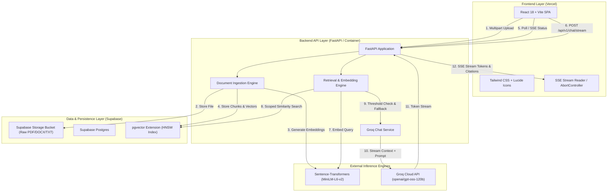
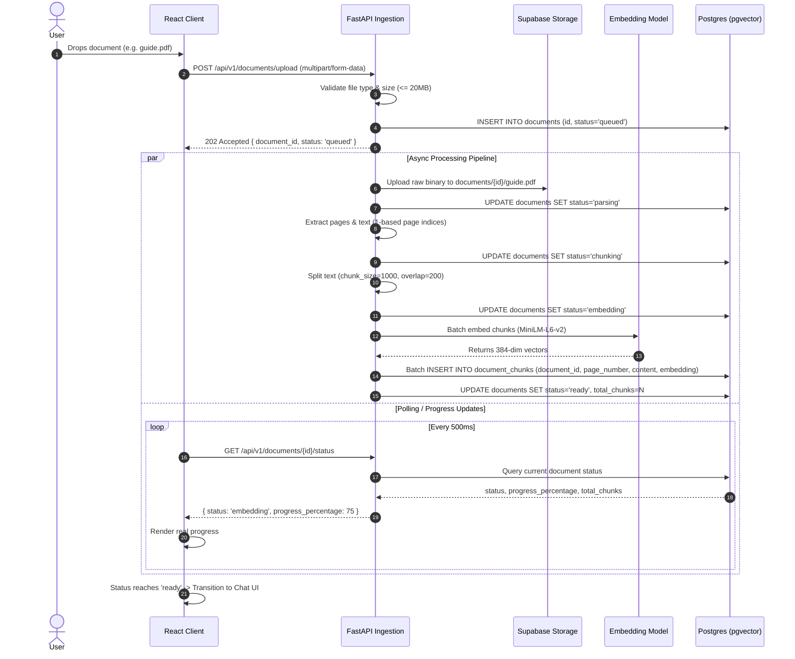
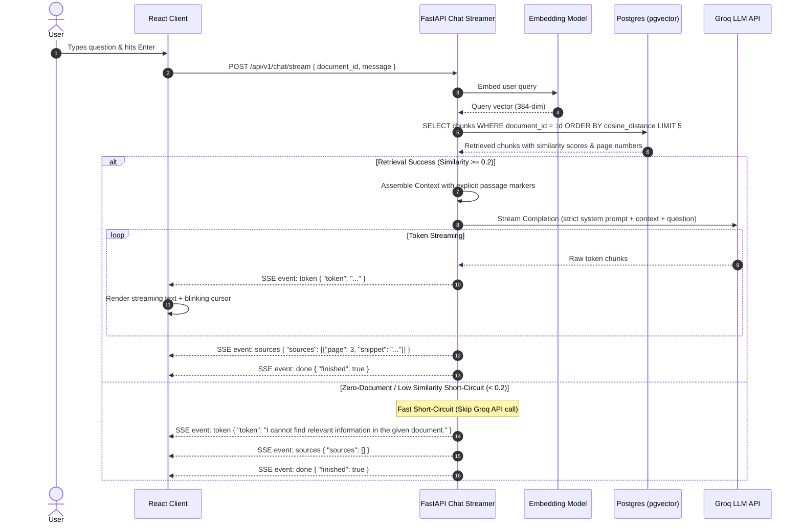

# System Architecture Document: DocChat Enterprise RAG

**Version:** 1.0.0  
**Status:** Backend, frontend integration, Supabase Postgres/pgvector, and private Storage verified end-to-end locally; deployment prepared, not executed  
**Target Environment:** Vercel (Frontend) + Containerized FastAPI (Backend) + Supabase (Postgres/pgvector + Storage) + Groq Cloud  

> **Authoritative wire contract:** [api-contract.md](api-contract.md). Examples in this
> document are illustrative; the contract and migrations are authoritative for
> field names, status codes, and SSE payloads. The React UI is wired to the live
> endpoints through `frontend/src/api.ts`.  

---

## 1. System Overview & Target Architecture

DocChat is engineered as a decoupled, cloud-native RAG system. The architecture separates user interface concerns, document ingestion/processing, vector similarity retrieval, and high-throughput LLM text generation.



---

## 2. Component Architecture & Responsibilities

### 2.1 Frontend (Vercel)
- **Framework:** React 18, TypeScript, Vite, Tailwind CSS.
- **Responsibilities:**
  - Drag-and-drop document upload interface (`DropZone`, `UploadScreen`).
  - Active document state management & sidebar drawer (`Sidebar`, `Brand`).
  - Real-time progress bar reading backend status states (`queued` -> `parsing` -> `chunking` -> `embedding` -> `ready`).
  - Real-time SSE streaming consumption with Markdown rendering and blinking cursor (`AssistantMessage`, `MessageList`).
  - Interactive source citation cards displaying real 1-based page numbers and verbatim text snippets (`SourceChips`, `SourceCard`).
  - Request aborting via `AbortController` (`Composer` stop button).

### 2.2 Backend Service (FastAPI)
- **Framework:** FastAPI, Uvicorn, Pydantic v2.
- **Responsibilities:**
  - File upload parsing, MIME/magic byte validation, size checking (<= 20MB).
  - Document conversion and page-aware chunking (`pypdf`, `docx2txt`, `RecursiveCharacterTextSplitter`).
  - Embedding computation and batch indexing in Supabase Postgres.
  - Scoped vector retrieval strictly filtered by `document_id`.
  - Zero-retrieval threshold evaluation and fast short-circuiting.
  - Groq streaming generation formatted as Server-Sent Events (SSE).

### 2.3 Storage & Persistence (Supabase)
- **Supabase Storage:**
  - Bucket: `documents` (private bucket).
  - Object Path: `{document_id}/{sanitized_filename}`.
- **Supabase Postgres (with pgvector):**
  - Relational metadata for documents, ingestion status, and processing logs.
  - Chunk table storing text passages, 1-based page numbers, and vector embeddings (`vector(384)`).
  - Hierarchical indexing using HNSW (`m=16`, `ef_construction=64`) for sub-100ms vector search.

### 2.4 External Inference
- **Embeddings:** `sentence-transformers/all-MiniLM-L6-v2` (384 dimensions) for high-efficiency semantic search.
- **LLM Generation:** Groq Cloud API using `openai/gpt-oss-120b` by default (set `GROQ_MODEL` to a model enabled for the key), temperature `0.0`, for deterministic, sub-second grounded responses.

---

## 3. End-to-End Data Flows

### 3.1 Document Ingestion & Indexing Flow



### 3.2 Query, Retrieval & Grounded Streaming Flow



---

## 4. Database Schema (Postgres + pgvector DDL)

```sql
-- Enable the vector extension
CREATE EXTENSION IF NOT EXISTS vector;

-- Table: documents
CREATE TABLE IF NOT EXISTS documents (
    id UUID PRIMARY KEY DEFAULT gen_random_uuid(),
    name TEXT NOT NULL,
    mime_type TEXT NOT NULL,
    size_bytes BIGINT NOT NULL,
    storage_path TEXT NOT NULL,
    status TEXT NOT NULL CHECK (status IN ('queued', 'parsing', 'chunking', 'embedding', 'ready', 'failed')),
    progress_percentage INT NOT NULL DEFAULT 0,
    total_pages INT DEFAULT 0,
    total_chunks INT DEFAULT 0,
    error_message TEXT,
    created_at TIMESTAMPTZ NOT NULL DEFAULT timezone('utc'::text, now()),
    updated_at TIMESTAMPTZ NOT NULL DEFAULT timezone('utc'::text, now())
);

-- Table: document_chunks
CREATE TABLE IF NOT EXISTS document_chunks (
    id UUID PRIMARY KEY DEFAULT gen_random_uuid(),
    document_id UUID NOT NULL REFERENCES documents(id) ON DELETE CASCADE,
    chunk_index INT NOT NULL,
    page_number INT NOT NULL, -- Strictly 1-based page indexing
    content TEXT NOT NULL,
    metadata JSONB DEFAULT '{}'::jsonb,
    embedding vector(384) NOT NULL,
    created_at TIMESTAMPTZ NOT NULL DEFAULT timezone('utc'::text, now())
);

-- Indexing for fast scoped retrieval
CREATE INDEX IF NOT EXISTS idx_chunks_document_id ON document_chunks(document_id);

-- HNSW vector similarity index for cosine distance (<=>)
CREATE INDEX IF NOT EXISTS idx_chunks_embedding_hnsw 
ON document_chunks 
USING hnsw (embedding vector_cosine_ops) 
WITH (m = 16, ef_construction = 64);
```

---

## 5. API Contracts (REST & SSE Specifications)

### 5.1 Document Upload
- **Endpoint:** `POST /api/v1/documents/upload`
- **Content-Type:** `multipart/form-data`
- **Request:**
  - `file`: Binary file (`.pdf`, `.docx`, `.txt`)
- **Response:** `202 Accepted`
  ```json
  {
    "document_id": "8f3b2049-74d6-4447-b8f9-c68e1a6136de",
    "name": "PMBOK_Guide_7th_Edition.pdf",
    "status": "queued",
    "created_at": "2026-10-25T15:20:00Z"
  }
  ```

### 5.2 Document Status Telemetry
- **Endpoint:** `GET /api/v1/documents/{document_id}/status`
- **Response:** `200 OK`
  ```json
  {
    "document_id": "8f3b2049-74d6-4447-b8f9-c68e1a6136de",
    "name": "guide.pdf",
    "status": "embedding",
    "progress_percentage": 75,
    "total_pages": 42,
    "total_chunks": 140,
    "chunks_processed": 105,
    "error_message": null,
    "created_at": "2026-10-25T15:20:00Z"
  }
  ```

### 5.3 List Documents
- **Endpoint:** `GET /api/v1/documents`
- **Response:** `200 OK`
  ```json
  [
    {
      "document_id": "8f3b2049-74d6-4447-b8f9-c68e1a6136de",
      "name": "PMBOK_Guide_7th_Edition.pdf",
      "status": "ready",
      "size_bytes": 2468000,
      "total_pages": 42,
      "total_chunks": 140,
      "created_at": "2026-10-25T15:20:00Z"
    }
  ]
  ```

### 5.4 Delete Document
- **Endpoint:** `DELETE /api/v1/documents/{document_id}`
- **Response:** `204 No Content`

### 5.5 Chat Stream (SSE)
- **Endpoint:** `POST /api/v1/chat/stream`
- **Headers:** `Accept: text/event-stream`
- **Request Body:**
  ```json
  {
    "document_id": "8f3b2049-74d6-4447-b8f9-c68e1a6136de",
    "message": "What are the eight project performance domains?"
  }
  ```
- **Stream Protocol (SSE):**
  ```text
  event: token
  data: {"type": "token", "value": "The"}

  event: token
  data: {"type": "token", "value": " eight"}

  event: token
  data: {"type": "token", "value": " project"}

  event: sources
  data: {"type": "sources", "value": [{"filename": "guide.pdf", "page": 38, "snippet": "...", "chunk_index": 214, "score": 0.71}]}

  event: done
  data: {"type": "done", "finished": true}
  ```

---

## 6. Environment Variables Specification

| Variable Name | Required | Target Layer | Description | Security Scope |
| :--- | :--- | :--- | :--- | :--- |
| `GROQ_API_KEY` | Yes | Backend | Groq Cloud API authentication key | Server-only secret; never exposed to client |
| `GROQ_MODEL` | No | Backend | Model identifier (Default: `openai/gpt-oss-120b`, must be enabled for the key) | Server configuration |
| `SUPABASE_URL` | Yes | Backend | Supabase Project REST/Postgres URL | Server configuration |
| `SUPABASE_SERVICE_ROLE_KEY` | Yes | Backend | Supabase elevated admin key for storage and DB inserts | Server-only critical secret |
| `DATABASE_URL` | Yes | Backend | Direct PostgreSQL connection string (pooler) | Server-only secret |
| `EMBEDDING_MODEL_NAME` | No | Backend | Local or hosted HF embedding model | Server configuration |
| `SIMILARITY_THRESHOLD` | No | Backend | Min cosine similarity for grounding (Default: `0.2`) | Server configuration |
| `VITE_API_BASE_URL` | Yes | Frontend | Base URL pointing to deployed FastAPI instance | Public client-side configuration |

---

## 7. Security Architecture & Threat Mitigation

1. **Zero Secret Leakage:**
   - No diagnostic script prints file contents or environment values.
   - Root-level `.gitignore` excludes `.env`, `.env.*`, runtime storage, caches, and build output; only `.env.example` templates are tracked.
2. **Strict Multi-Document Isolation:**
   - In pgvector, every query incorporates `WHERE document_id = :target_id`. No query is executed without explicit document scoping.
3. **Payload Sanitization & Magic Byte Checking:**
   - PDF uploads must match magic byte `%PDF-`.
   - File size restricted at the gateway level (Nginx/FastAPI) to 20MB.
4. **CORS Enforcement:**
   - FastAPI middleware restricted strictly to configured frontend origin (`https://docchat-app.vercel.app` and `http://localhost:5173`).

---

## 8. Risk Analysis & Mitigation Matrix

| Risk | Impact | Probability | Mitigation Strategy |
| :--- | :--- | :--- | :--- |
| **Groq 429 Rate Limits** | High | Medium | Add exponential backoff and a model/route fallback before public exposure. |
| **High Memory during PDF Parsing** | Medium | Medium | Stream large PDFs page-by-page using generator-based loaders; avoid loading entire document text in a single buffer. |
| **Zero Retrieval Hallucination** | High | Low | Hardcode short-circuit check: if `similarity < threshold` or `chunks.len == 0`, bypass LLM and return deterministic fallback. |
| **Desynchronized Frontend State** | Low | Medium | Expose explicit `document_id` in chat stream requests and validate document presence before initiating streaming. |
